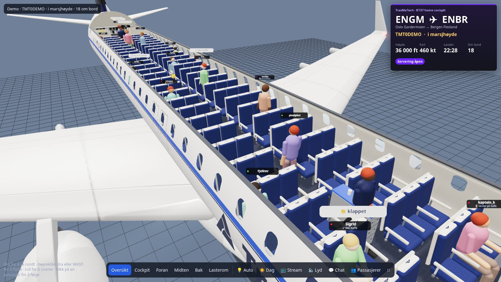
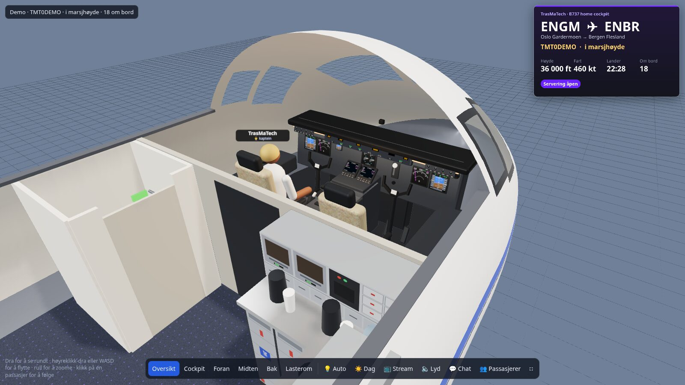

# trasma-cabin-xr

TrasMaTech-flyet som et dukkehus: en Boeing 737 med taket kuttet av, der passasjerene fra chatten,
kabinpersonalet og kapteinen lever live etter [TrasmaBot](https://trasmabot.trasma.tech/). Nettleser,
VR og AR (Quest 3). three.js + WebXR.


| Servering i kabinen | Cockpit og bysse |
|---|---|
|  |  |

*Tatt i demomodus med oppdiktede navn.*

## Kjøre

```bash
npm install
npm run dev                 # http://localhost:5173
```

Quest: `npm run dev:quest` (HTTPS på nettverket) eller `adb reverse tcp:5173 tcp:5173` over USB.

Utrulling: `npm run build`, så `PORT=7000 TLS_CERT=… TLS_KEY=… node server.mjs` (uten TLS: HTTP).

## Styring

- **Desktop:** visninger 1–6, klikk en passasjer for å følge, dra for å se rundt, WASD for å flytte,
  rull for å zoome. P = passasjerliste, N = dag/natt, B = kabinlys, L = lyd, T = stream, C = chat.
- **VR:** pek og trykk for å flytte deg, A/X og B/Y bytter visning, stikkene flytter og snur.
- **AR:** avtrekkeren plasserer flyet, grepknappen flytter, to hender zoomer og roterer.

`?navn=chatnavn` følger en chatter, `?demo=CRUISE` kjører en oppdiktet tur, `?lav` slår av skygger.

## Data

Leser TrasmaBots udokumenterte `live.php?d=kabin|kart` og lydfilene i `kabinlyd/`. De har ikke CORS,
så Vite (dev) og `server.mjs` (prod) videresender dem. Alt renses i `src/data.js`.
