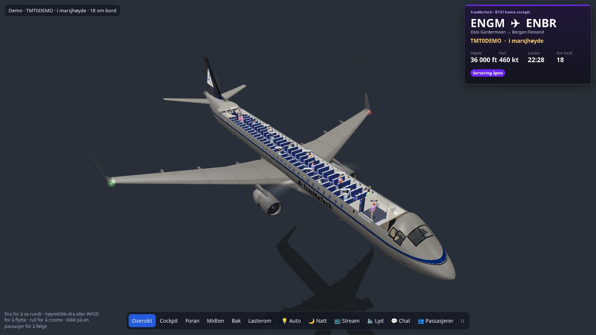

# trasma-cabin-xr



| Servering i kabinen | Cockpit og bysse |
|---|---|
|  |  |

*Skjermbildene er tatt i demomodus (`?demo=CRUISE`) med oppdiktede navn.*

TrasMaTech-flyet som et dukkehus i VR: en Boeing 737 i full størrelse med taket kuttet av, sett
ovenfra, der livet om bord synkes med TrasmaBots live-data fra
[trasmabot.trasma.tech](https://trasmabot.trasma.tech/). Bygd med three.js og WebXR.

- **Flyet:** skrog med TrasMaTech-lakk, vinduer, vinger med winglets, motorer, haleflater og
  understell (når flyet står på bakken). Taket er kuttet over hodehøyde.
- **Kabinen:** bygges fra seteoppsettet i dataene (rader, `ABC|DEF`, rader som mangler), med
  stoffseter, armlener, nakketrekk, klappbord, teppe, nødlys, bysser, toaletter og cockpit med
  kapteinen i venstre sete.
- **Passasjerene fra chatten** sitter i setene sine med navnelapp. De leser, ser film, hører på
  musikk, bruker nettbrett eller sover, og de går via midtgangen når de skal på toalettet (opptatt-lys,
  kø i midtgangen) eller strekker på beina.
- **Kabinpersonalet** følger serveringsvogna når serveringen er åpen og står ellers i byssene.
  Setebelteskiltet lyser når beltet er på.
- **Cockpit (737-800NG):** hovedpanel med seks live-skjermer (PFD med horisont og tapes, ND med
  SimBrief-ruta, øvre og nedre EICAS), MCP og EFIS på glareshielden, pidestall med to CDU-er
  (PROGRESS), gasshendler, speedbrake, flaps, trimhjul og radiopaneler; 737-ratt, pedaler,
  saueskinnseter og tiller. Hjulspak, gass og flaps følger fasen. Dempet med indirekte lys.
- **Eksteriør:** vinger med ekte profil, knekk, pilform og blended winglets, flapskinneskjold,
  buk-fairing, TrasMaTech-logo på finne (kanalens profilbilde), skrog og motorer, glass i
  cockpitvinduene, navigasjonslys, beacon, strober og logolys.
- **Dag, kveld og natt:** Auto ut fra solhøyden der flyet er, eller valgt selv (N). Utsiden dempes,
  kabinen holder seg lys, cockpit litt mørkere.
- **Kabinlyden (🔈 Lyd, L):** de samme lydfilene og hendelsene som live-kabinen på nettsiden, spilt i 3D
  fra der det skjer (hosting fra setet, vogna i midtgangen, spyling på toalettet). Volum per gruppe følger
  crew sine innstillinger; filene går via `/kabinlyd/` (proxy, ingen CORS hos TrasmaBot). Innlest tale er ikke med.
- **Omgivelsene:** et nøytralt mørkt rom med rutenett. I lufta synker bakken og glir forbi i
  bakkefarten. Infotavla viser rute, fase, høyde, fart, landingstid og antall om bord.

## Kjøre

```bash
npm install
npm run dev          # http://localhost:5173 – desktop, eller Quest via adb reverse (se under)
npm run dev:quest    # HTTPS på LAN/Tailscale for Quest-nettleseren
```

### På Meta Quest

WebXR krever en sikker kontekst. To måter:

1. **USB:** `adb reverse tcp:5173 tcp:5173`, så åpne `http://localhost:5173` i Quest-nettleseren.
2. **Nettverk:** `npm run dev:quest` og åpne `https://<maskin-ip>:5173` (LAN eller Tailscale).
   Sertifikatet er selvsignert, så godta advarselen én gang.

Trykk **Enter VR**. Du starter stående over rad 1 og ser mot nesa (referanserom `local-floor`).

### Utrulling

`server.mjs` serverer `dist/` og videresender bare `/api/live?d=kabin|kart` og lydfilene
(`/kabinlyd/`) til TrasmaBot, med cache så alle seere deler kallene. Den er laget for å kjøre som en
systemd-brukertjeneste:

```bash
npm run build
PORT=7000 TLS_CERT=/sti/cert.pem TLS_KEY=/sti/key.pem node server.mjs   # uten TLS_*: vanlig HTTP
```

`RUTER_IP` (valgfri) er IP-en til ruteren. Trafikk som kommer inn via port-videresending kan ha den
som avsender, og den regnes da ikke som hjemmenettet når `/api/stats` sjekker hvem som spør.

Endringer går ut av seg selv: `trasma-cabin-xr-bygg` kjører `vite build --watch`, serveren merker
nytt bygg og sender beskjed over `/api/versjon`, og åpne faner laster seg på nytt.
`trasma-cabin-xr-server.path` starter serveren på nytt når `server.mjs` endres.

## Styring

| Hvor | Hva |
|---|---|
| Desktop | Visninger i verktøylinja eller 1–6, klikk på en passasjer for å følge (Esc slipper), dra for å se rundt, høyreklikk-dra eller WASD/Q/E for å flytte, rull for å zoome mot pekeren, P = passasjerliste, N = dag/kveld/natt, F = fullskjerm. |
| AR (Quest 3, «START AR») | Flyet står i rommet ditt som modell 1:30 med passthrough. Avtrekkeren setter det der ringen viser (bord eller gulv). Grepknappen: én hånd flytter, to hender zoomer og roterer. Venstre stikke opp/ned = størrelse, høyre stikke sideveis = snu, opp/ned = høyde. |
| VR | Du står på et usynlig gulv over flyet. Pek og trykk på avtrekkeren for å flytte deg dit, A/X og B/Y bytter visning. Venstre stikke flytter deg, høyre stikke snur (sideveis) og endrer høyden (opp/ned). Infotavla sitter på venstre hånd. |

## URL-parametre

| Parameter | Eksempel | Hva |
|---|---|---|
| `navn` | `?navn=chatnavn` | Fremhev en chatter (lilla navnelapp, og setet vises på infotavla). |
| `demo` | `?demo=1`, `?demo=CRUISE` | Kjør en kort tur i løkke med oppdiktede passasjerer, for testing når de ikke flyr. |
| `lav` | `?lav` | Uten skygger, for svakere enheter. |
| `forsinkelse` | `?forsinkelse=0` | Sekunder appen ligger bak boten. Standard er det samme som nettsiden bruker for lyden (`lyd.forsinkelse`, ~5 s), så appen treffer samtidig med streamen og kabinlyden i den. 0 = alt med en gang. |

## Data

`live.php?d=kabin` og `live.php?d=kart` er TrasmaBots egne, udokumenterte endepunkter (de samme som
live-kabinen og live-kartet på nettsiden bruker). De sender ingen CORS-hoder, så Vite proxyer dem
som `/api/live`. En utrullet versjon trenger den samme proxyen. Alt som kommer derfra renses i
`src/data.js` før det brukes. Kabinen hentes hvert 4. sekund og kartet hvert 5. sekund.

## Filer

| Fil | Innhold |
|---|---|
| `src/main.js` | Renderer, kamera/orbit, VR-flytting, datahenting og løkka |
| `src/data.js` | Henting, rensing og demo-data |
| `src/cabin.js` | Mål, seteoppsett og alt inne i kabinen (seter, bysser, toaletter, cockpit, vogn) |
| `src/hull.js` | Flyet utenfra: skrog med snitt, lakk, vinger, motorer, hale og understell |
| `src/people.js` | Passasjerer, kabinpersonale og kaptein: stillinger, gange og aktiviteter |
| `src/world.js` | Rommet rundt: lys, skygger, rutenett og bevegelse i lufta |
| `src/screen.js` | Infotavla |
| `src/cockpit.js` | Cockpit: panel, pidestall, ratt, seter og indirekte lys |
| `src/displays.js` | Live-instrumentene (PFD, ND, EICAS, CDU, MCP) og flytilstanden de viser |
| `src/cargo.js` | Lasterommet med TrasMaTech Express-pakkene |
| `src/textures.js` | Prosedyriske teksturer (setestoff, teppe, bysse, lakk) |
